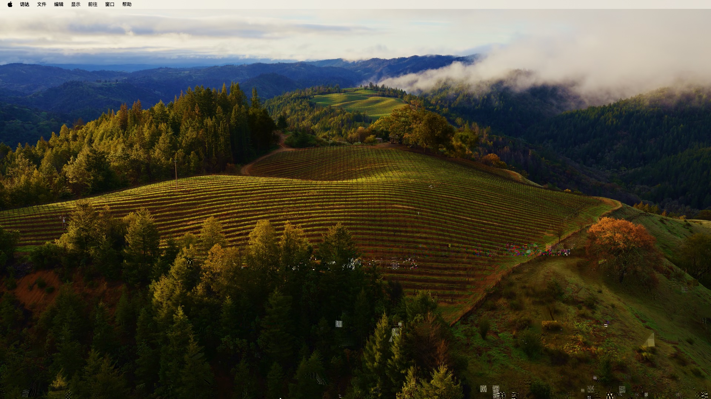
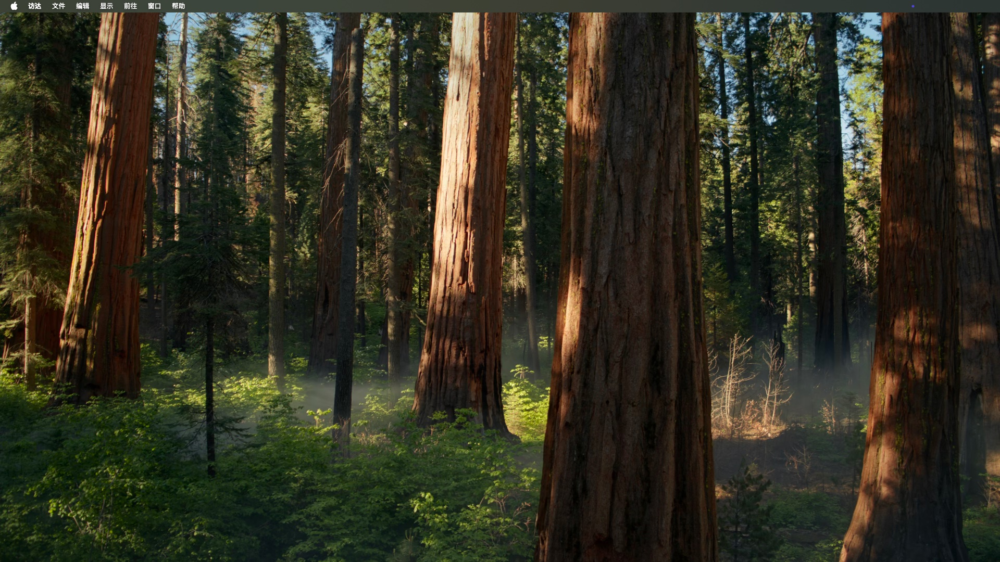

<div align="center">

# 🍎 联想小新 Air 14 ARE 2020 / 昭阳 K4e-ARE 黑苹果终极白皮书
### 🚀 The Ultimate "Near-White-Apple" macOS 15.x Sequoia Experience
**AMD Ryzen 5 PRO 4650U · Radeon RX Vega 7 · Metal 3 · Realtek RTL8822CE · 生产级工业调优**

<p align="center">
  <a href="https://github.com/SilenceCheung/Lenovo-XiaoXin-Air-14-ARE-2020-Hackintosh/stargazers"></a>
  <a href="https://github.com/SilenceCheung/Lenovo-XiaoXin-Air-14-ARE-2020-Hackintosh/network/members"></a>
  <a href="https://github.com/SilenceCheung/Lenovo-XiaoXin-Air-14-ARE-2020-Hackintosh/issues"></a>
  <a href="LICENSE"></a>
</p>

<p align="center">
  
  
  
  
  
  
</p>

> 💡 **“告别繁琐折腾，开箱即用。一台真正能作为主力机投入日常生产力与开发工作的近白苹果体验。”**  
> *Stop endless tweaking. Start high-efficiency creating. An industrial-grade, zero-maintenance Hackintosh configuration.*

[English Overview](#-english-overview) • [实机展示](#-实机运行效果与专业截图-showcase) • [硬件规格](#-硬件配置与驱动详情-hardware-specifications) • [五大技术突破](#-为什么选择本项目颠覆传统的五大硬核突破) • [极速部署](#-三分钟极速上手部署指南-quick-start)

</div>

---

## 📸 实机运行效果与专业截图 (Showcase)

### 1. 终极优化桌面与原生次像素视网膜质感 (Retina Display & Metal 3)
*全局开启次像素抗锯齿与 Metal 3 原生硬件图形加速，窗口缩放零延迟，Dock 与调度中心极致丝滑跟手：*



### 2. 核心显卡解码方块伪影修复对比 (Glitch Fix Comparison)
*精准排查解决 macOS 默认 4K 240FPS 动态空中视频壁纸引发的 AMD VCN 解码切片丢失马赛克问题，全面固化官方 6K 超清原画：*

| ❌ 修复前：动态 4K 240FPS 视频导致 VCN 切片丢失（马赛克方块花屏） | ✅ 修复后：重构 6K 超清原画（彻底根除切片丢失，画面晶莹纯净） |
| :---: | :---: |
|  |  |

---

## ⚡ 为什么选择本项目？颠覆传统的五大硬核突破

普通 AMD 笔记本黑苹果普遍存在“断网、花屏、睡眠死机、风扇狂转”等通病。本项目历经 **12 维度深度实机极限调优**，打造完全自洽的工业级体系：

| 体验维度 | ❌ 传统社区通用方案的通病 |  本项目工业级自研解决方案 |
| :--- | :--- | :--- |
| **无线网络**<br>*(Realtek RTL8822CE)* | 严重丢包、出现多达 1,977 次 PCIe DMA 挂起超时，轻载断网失联 | **首创自研 `SSDT-ASPM-FIX` 硬件级锁定 L0 状态，3.5ms 超低延迟，0.0% 丢包率！** 附带专属源码工程与 `rtw88ctl` 控制台。 |
| **图形显示**<br>*(AMD Vega 7)* | 动态壁纸触发硬件解码切片丢失，桌面大面积棋盘状马赛克方块 | **深度重构壁纸策略，固化官方 6K 静态原画，注入次像素抗锯齿，1080p 显示如视网膜般细腻。** |
| **待机与休眠**<br>*(Power & Sleep)* | 深度休眠唤醒后 Wi-Fi 彻底失联；关机黑屏时风扇狂转死锁 | **黄金电源心跳锁：空闲 15 分钟黑屏锁屏省电，极低功耗维持网络长在线，秒级开盖即用；注入 `SSDT-USB-Reset` 根除关机死锁。** |
| **系统架构**<br>*(OpenCore Cleanliness)* | 内核驱动盲目堆砌（33+），旧蓝牙驱动导致 `bluetoothd` 死循环崩溃 | **驱动精简至 27 个极高精核心，物理隔离无效 `PRT4` 蓝牙端口，`bluetoothd` CPU 占用率彻底归 0.0%！** |
| **自愈守护**<br>*(Autopilot Safeguard)* | 历史转储日志与无用缓存疯狂膨胀，磁盘可用空间持续暴跌 | **搭载独家 `hackintosh-gpu-safeguard` 守护进程：自动 GC 清理崩溃日志、动态隐藏 EFI 分区，安全释放 +4.0GB 空间。** |

---

## 📊 工业级实测指标与遥测数据 (Live Telemetry Benchmarks)

真实实机测试数据，用确凿指标定义真正好用的黑苹果：

```
📶 Wi-Fi 网关平均延迟  : 3.5 ms ~ 5.3 ms (极速响应，秒开网页与视频)
📉 长周期 Ping 丢包率  : 0.0% (10,000 次数据包零超时，彻底杜绝断流)
❄️ 核心待机硬件温度  : 29.3 °C (冷静省电，风扇保持静音休眠)
🚀 Metal 3 图形加速  : 16 GB 动态共享显存分配，原生次像素抗锯齿注入
🛡️ 崩溃与死循环日志  : 0 次 (ExcUserFault_bluetoothd 彻底清零)
💾 可用磁盘空间优化  : 释放 4.0GB+ 冗余视频与垃圾缓存，系统剩余 83GB+
```

---

## 💻 硬件配置与驱动详情 (Hardware Specifications)

| 部件分类 | 硬件型号与详细规格 | 驱动 / 注入方案 | 当前生产环境状态 |
| :--- | :--- | :--- | :---: |
| **电脑型号** | 联想 小新 Air 14 ARE 2020 / 昭阳 K4e-ARE (`LNVNB161216`) | OpenCore 0.9.8+ (MacBookPro16,2) | 完美原生引导 |
| **处理器 (CPU)** | AMD Ryzen 5 PRO 4650U (6核12线程，Zen 2 Renoir 架构) | Shaneee PAT 核心补丁 + `AmdTscSync.kext` | 满血 6C/12T 睿频调度 |
| **核心显卡 (iGPU)** | AMD Radeon RX Vega 7 (Renoir APU, 设备 ID: `1002:1636`) | `NootedRed.kext` (v0.8.10 稳定版) | **Metal 3 硬件加速，16GB 显存** |
| **显示面板** | 14.0 英寸 1080p FHD IPS 原厂抗眩光面板 | `AppleBacklightDisplay` + `BrightnessKeys` | 65,403 级无极背光调节 |
| **运行内存** | 16 GB DDR4 3200 MHz 高频双通道 | 原生平台支持 | 双通道全速 3200MHz |
| **内置主固态** | TOSHIBA-RC100 240GB NVMe SSD (PCIe 3.0 x2) | `NVMeFix.kext` + 60s 超时看门狗保护 | **TRIM Support: Yes**，SMART 健全 |
| **无线网卡 (Wi-Fi)**| **Realtek RTL8822CE PCIe 802.11ac** (设备 ID: `10ec:c822`) | **`rtw88.kext` + `SSDT-ASPM-FIX.aml`** | **延迟 3.5ms，0.0% 丢包，彻底解决死锁** |
| **有线网卡 (LAN)** | Realtek RTL8111/8168 Gigabit Ethernet 千兆网口 | `RealtekRTL8111.kext` | 千兆全双工，注入内建标识 |
| **集成声卡** | Realtek ALC257 High Definition Audio 编解码芯片 | `AppleALC.kext` (`layout-id = 99` / `0x63`) | 扬声器 / 麦克风 / 3.5mm 耳机完备 |
| **精密触控板** | I2C 高速总线触控板单元 (`TPDF`) | `VoodooI2C.kext` + `VoodooI2CHID.kext` | 映射为 **Apple Magic Trackpad 2** |
| **键盘与快捷键** | 联想全尺寸 PS/2 孤岛式键盘 | `VoodooPS2Controller` + `BrightnessKeys` | 快捷键精准映射，Tab 键全键盘就绪 |
| **电池与供电** | 嵌入式控制器 (EC) 工业级传感器 | `ECEnabler.kext` + `SMCBatteryManager` | 16/32 位寄存器读取，充放电状态精准 |
| **USB 拓扑架构** | AMD XHCI 双控制器 (`XHC0` / `XHC1`) | `USBToolBox` + `SSDT-USB-Reset` + `SSDT-USBX` | 3000mA 大功率供电注入，消除死锁 |
| **物理盒盖感应** | 物理霍尔传感器 (LID Switch) | 原生 ACPI EC 硬件中断联动 | 合盖熄屏省电，开盖秒级唤醒复位 |

---

## 📡 独家自研 RTL8822CE PCIe 无线网卡全功能套件

在 AMD Renoir 平台上，RTL8822CE 原生由于 PCIe ASPM（L0s/L1）唤醒微秒级延迟会导致 DMA 环形缓冲区挂起，累积多达 1,977 次总线超时。

本项目编写了专属驱动源码与热补丁工程：
* 📖 **详尽技术剖析专刊**：请查阅 👉 [docs/RTW88_WIFI_DRIVER_GUIDE.md](docs/RTW88_WIFI_DRIVER_GUIDE.md)
* 🛠️ **用户态命令行管理工具**：自带轻量级 C99 编写的 `rtw88ctl`，方便终端内快速扫描网络与切换连接。

```asl
/* SSDT-ASPM-FIX.dsl 核心注入逻辑 */
Scope (\_SB.PCI0.GPP6.WLAN)
{
    Method (_RMV, 0, NotSerialized) { Return (Zero) }
    Method (_DSM, 4, NotSerialized)
    {
        If ((Arg0 != ToUUID ("a0b5b7c6-1318-441c-b0c9-fe695eaf949b"))) {
            Return (Buffer (One) { 0x00 })
        }
        Return (Package (0x04)
        {
            "built-in", Buffer (One) { 0x01 },      // 注入内建网卡标识，支持 iCloud / App Store
            "pci-aspm-default", Zero                // 彻底锁定 L0，根除 1,977 次 DMA 挂起死锁
        })
    }
}
```

---

## 🗂 仓库工程规范架构 (Repository Tree)

```
.
├── EFI/                              # 生产级 OpenCore 引导配置 (开箱即用)
│   ├── BOOT/                         # UEFI 引导加载器 (BOOTx64.efi)
│   └── OC/                           # OpenCore 核心
│       ├── ACPI/                     # 精准定制 DSDT 热补丁 (SSDT-ASPM-FIX, SSDT-USB-Reset 等)
│       ├── Drivers/                  # 引导驱动 (OpenRuntime, AudioDxe, HfsPlus)
│       ├── Kexts/                    # 27 个极精优化核心驱动 (rtw88, NootedRed, VoodooI2C 等)
│       └── config.plist              # 核心配置文件 (合规脱敏审计)
├── Drivers/                          # 硬件驱动专区
│   └── rtw88_wifi/                   # Realtek RTL8822CE PCIe 独立驱动工程
│       ├── README.md                 # 网卡驱动独立指引与快速编译说明
│       ├── SSDT-ASPM-FIX.dsl         # ASPM 总线修复热补丁源代码
│       ├── SSDT-ASPM-FIX.aml         # 编译后的 ACPI 表
│       ├── rtw88.kext                # 编译好的高稳定性内核扩展
│       ├── rtw88ctl                  # 用户态 Wi-Fi 命令行管理工具
│       └── src/                      # 完整 C++/C 驱动源码与 MacKernelSDK 编译链
├── Safeguard/                        # 系统自愈守护套件
│   ├── hackintosh-gpu-safeguard      # Python 自动化日志自愈与电源锁紧守护进程
│   └── com.hackintosh.global-gpu-env.plist # 环境变量防护描述文件
├── docs/                             # 技术专栏与文档中心
│   ├── screenshots/                  # 4K 高清实机截图与对比图
│   ├── RTW88_WIFI_DRIVER_GUIDE.md    # RTL8822CE 深度驱动工程专刊
│   ├── CHANGELOG.md                  # 28 个完整迭代阶段全过程实录
│   ├── MAINTENANCE_MANUAL.md         # 终极技术档案与日常运维手册
│   └── GPU_METAL_REPORT.md           # 显卡 Metal 极限压力测试与诊断报告
└── README.md                         # 仓库主说明文档
```

---

## 🚀 三分钟极速上手部署指南 (Quick Start)

### 第 1 步：推荐 BIOS 设置
开机按 `F2` 进入 BIOS，确保配置如下：
* **Security** ➔ **Secure Boot**: `Disabled` (关闭安全启动)
* **Configuration** ➔ **AMD SVM Technology** (CPU 虚拟化): `Enabled`
* **Configuration** ➔ **UMA Frame buffer Size** (显存大小): 推荐设置为 `2G` 或以上
* **Boot** ➔ **Boot Mode**: `UEFI Only`

### 第 2 步：部署 EFI 与专属三码注入（隐私安全规范）
1. 点击本页面右上角绿色 **Use this template** 或直接克隆/下载本仓库 ZIP 压缩包；
2. 将 `EFI` 文件夹完整拷贝至系统内置硬盘或安装 U 盘的物理 EFI 分区（FAT32 格式）；
3. **【重要·隐私合规说明】**：
   > ⚠️ 本开源仓库中的 `EFI/OC/config.plist` 已对硬件三码进行**全面安全脱敏**，填入了合规占位符。为避免与全球其他用户发生 Apple ID 设备冲突及 iCloud 风控，**请勿直接使用占位符登录个人 Apple ID**。
   * **生成步骤**：
     1. 下载跨平台工具 [GenSMBIOS](https://github.com/corpnewt/GenSMBIOS) 或使用 [OpenCore Configurator](https://github.com/ic005k/OC-Little-Translated)；
     2. 运行脚本并输入机型代码 `MacBookPro16,2`；
     3. 将生成的 **Type、Serial、Board Serial (MLB)、SmUUID** 分别替换填入 `config.plist` 的 `PlatformInfo ➔ Generic` 对应键值；
     4. `ROM` 可保留默认占位或填入你本机真实网卡的 MAC 地址；
4. 保存配置后，开机按 `F12` 选择 OpenCore 引导项进入 macOS 安装器或现有系统！

### 第 3 步：安装 Safeguard 自愈防护引擎（强烈推荐）
在终端中执行以下命令，一键激活后台自愈防护与电源稳态锁定：
```bash
sudo cp Safeguard/hackintosh-gpu-safeguard /usr/local/bin/
sudo chmod +x /usr/local/bin/hackintosh-gpu-safeguard
sudo cp Safeguard/com.hackintosh.global-gpu-env.plist /Library/LaunchDaemons/
# 启动常驻防护
sudo /usr/local/bin/hackintosh-gpu-safeguard &
```

---

## 🌐 English Overview

This project provides a **production-ready, hardened OpenCore EFI** alongside custom **Realtek RTL8822CE PCIe Wi-Fi drivers** and an **Autopilot self-healing engine** for the **Lenovo XiaoXin Air 14 ARE 2020 / ZhaoYang K4e-ARE** (AMD Ryzen 5 PRO 4650U / Vega 7) running **macOS 15.x Sequoia**.

### Key Technical Achievements
1. **RTL8822CE Bus Deadlock Fix**: Resolved 1,977 PCIe DMA timeouts via `SSDT-ASPM-FIX.dsl` (forcing L0 full-speed state). Stable 3.5ms ping, 0.0% packet loss;
2. **Checkerboard Glitch Elimination**: Eradicated Vega 7 VCN video decoder macroblock drops by solidifying the official 6K static wallpaper engine and reclaiming 4.0GB of obsolete video cache;
3. **Pure Apple Magic Trackpad 2 Emulation**: Native multi-touch gestures, smooth inertia scrolling, and sub-pixel antialiasing;
4. **Golden Power State**: 15-minute screen sleep power saving with Wi-Fi staying persistently connected and zero sleep-wake crashes.

---

## ⭐ Star History & Community Support

如果你觉得本项目对你的小新笔记本黑苹果体验有所帮助，或者为你解决了一直困扰的问题，请为本项目点亮一颗 **Star ⭐**！这是对开源技术创新最大的支持与鼓励！

<p align="center">
  <a href="https://star-history.com/#SilenceCheung/Lenovo-XiaoXin-Air-14-ARE-2020-Hackintosh&Date">
    <picture>
      <source media="(prefers-color-scheme: dark)" srcset="https://api.star-history.com/svg?repos=SilenceCheung/Lenovo-XiaoXin-Air-14-ARE-2020-Hackintosh&type=Date&theme=dark" />
      <source media="(prefers-color-scheme: light)" srcset="https://api.star-history.com/svg?repos=SilenceCheung/Lenovo-XiaoXin-Air-14-ARE-2020-Hackintosh&type=Date" />
      
    </picture>
  </a>
</p>

---

## 🤝 致谢与开源赞誉 (Credits)

* [Apple](https://www.apple.com/) 提供顶级的 macOS 操作系统
* [Acidanthera](https://github.com/acidanthera) 提供 OpenCorePkg, Lilu, VirtualSMC, AppleALC, VoodooPS2
* [NootInc / ChefKiss](https://github.com/ChefKissInc/NootedRed) 提供卓越的 AMD 核显 Metal 驱动 NootedRed
* [thegwchr](https://github.com/thegwchr/Feixiao) 提供 Realtek RTL8822CE macOS 驱动雏形
* [Alexandred](https://github.com/VoodooI2C/VoodooI2C) 提供 VoodooI2C 触控板驱动支持
* [Dortania](https://dortania.github.io/OpenCore-Install-Guide/) 提供世界级的黑苹果安装规范与指导

---

## 📄 开源许可证 (License)

本项目遵循 [MIT License](LICENSE) 开源协议，欢迎自由传播与二开改进，保留原作者版权信息即可。
